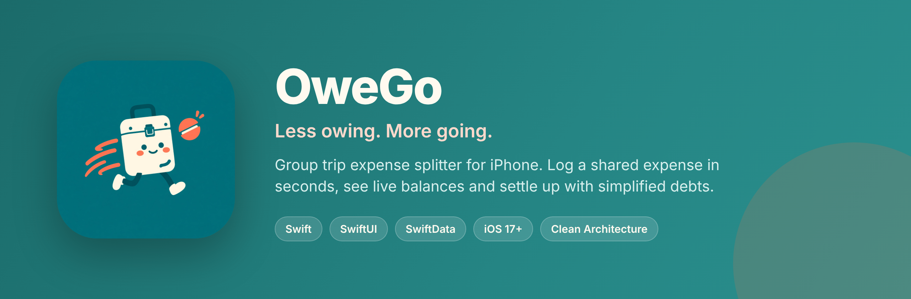
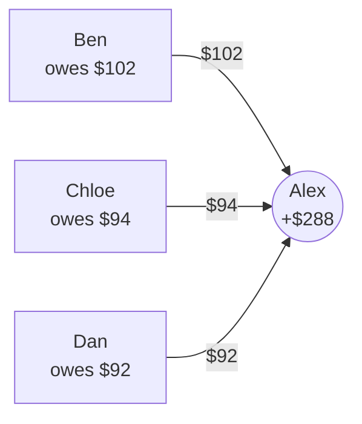
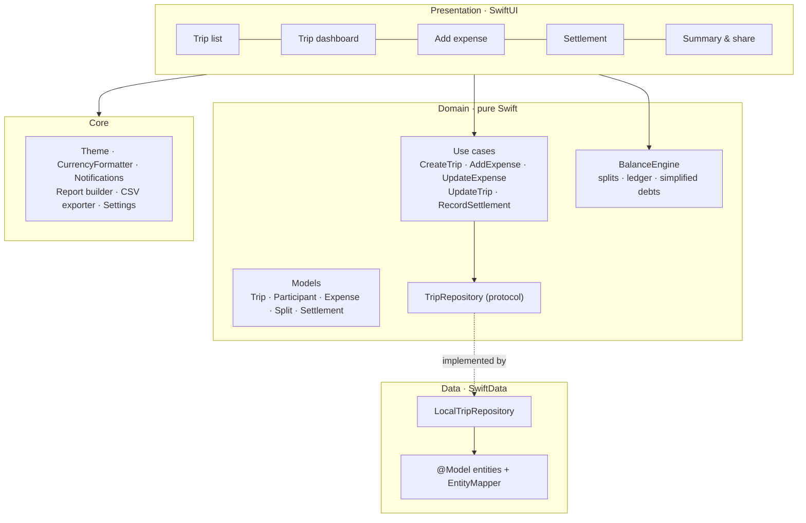

<p align="center">
  
</p>

<p align="center">
  
  
  
  
  
</p>

# OweGo: SwiftUI trip expense splitter

OweGo keeps group-trip money simple. Adding an expense takes a couple of taps: by default **you paid and everyone splits equally**, so you just type the amount and save. Balances update live as you go. At the end, the app works out who should pay whom with as few transfers as it can, and lets you send payment requests or open Venmo straight from the settle-up screen.

Everything runs **on the device** with SwiftData. There are no accounts and no backend.

---

## ✨ Features

| | |
|---|---|
| ⚡ **Fast expense entry** | Smart defaults (you paid, everyone shares). Pick a category: food, transport, lodging, activities, supplies or other |
| ➗ **Three split modes** | Equal, custom amounts or percentages. Rounding remainders are assigned so totals always add up to the cent |
| 📊 **Live balances** | A ledger per person (paid / share / balance) that updates with every change |
| 🔁 **Debt simplification** | A greedy creditor–debtor matching algorithm turns the ledger into a short list of "A pays B" transfers |
| 💸 **Settle up** | Record payments, copy a ready-made payment request, or open Venmo with your handle |
| 🧾 **Receipt photos** | Attach a photo to any expense with the system photo picker |
| 🔔 **Smart reminders** | Local notifications for your balance and a heads-up the day before a trip ends |
| 📤 **Share and export** | Share a group or per-person trip report, or export an Excel-friendly CSV |
| 🏁 **Trip wrap-up** | An end-of-trip summary with highlights like the biggest expenses and who fronted the most |

---

## 🧮 How settle-up works

Each person's **balance = what they paid − their share**. Positive means they're owed; negative means they owe.

Example from the test suite (four friends, $780 of shared spending):

| Person | Paid | Share | Balance |
|---|---:|---:|---:|
| Alex | $482 | $194 | **+$288** |
| Ben | $120 | $222 | −$102 |
| Chloe | $70 | $164 | −$94 |
| Dan | $108 | $200 | −$92 |



The engine sorts creditors and debtors by amount and pairs them off greedily. That gives **3 payments**, and every balance reaches zero.

---

## 🏗️ Architecture

The app uses Clean Architecture in four layers. The views never touch persistence directly; they go through use cases and a repository protocol, so the domain logic is pure Swift and easy to unit test.



### Project structure

```
OweGo/
├── App/            # @main entry point, dependency wiring
├── Domain/
│   ├── Models/     # Trip, Participant, Expense, Split, SplitMode, Settlement, ExpenseCategory
│   ├── UseCases/   # one type per user action
│   ├── Services/   # BalanceEngine
│   └── Repositories/
├── Data/           # SwiftData entities, mapper, LocalTripRepository
├── Presentation/   # SwiftUI features + shared components
└── Core/           # theme, formatters, notifications, reports, CSV export, settings
OweGoTests/         # BalanceEngine unit tests
docs/               # landing page, privacy policy, PRD, App Store release notes
```

---

## 🚀 Getting started

**Requirements:** Xcode 16+, iOS 17+ (SwiftData), iPhone or iPad simulator/device.

1. Open `OweGo.xcodeproj`.
2. Under **Signing & Capabilities**, select your own development team (needed for device builds).
3. Press **⌘R**.

Set your name and Venmo handle in **Settings** (the gear icon on the trip list).

### Run the tests

```bash
xcodebuild -scheme OweGo -sdk iphonesimulator \
  -destination 'platform=iOS Simulator,name=iPhone 16' test
```

The tests cover equal, custom and percentage splits, rounding remainders, excluding people from a split, ledger totals, partial and full settlements, and debt simplification.

---

## 🗺️ Roadmap

- **Now:** local-only, single device
- **Next:** cloud sync (Supabase), Sign in with Apple, invite links, and a web view for participants
- **Ideas:** receipt OCR (merchant, total and date), voice entry ("I paid $68 for gas for everyone except Chloe"), smarter defaults learned from each trip

Product notes and the full PRD are in [`docs/OweGo-PRD-Final.md`](docs/OweGo-PRD-Final.md). App Store release steps are in [`docs/RELEASE.md`](docs/RELEASE.md).
